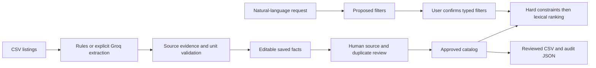

# PropertyData Copilot

Local property-listing normalization, reviewed catalog search and duplicate candidates. Optional
Groq calls extract text facts or propose query filters; deterministic rules preserve price bases and
apply confirmed hard constraints. This is a personal prototype, not a valuation or investment service.

## Start (Python 3.11+, Windows PowerShell)

```powershell
python -m venv .venv
.\.venv\Scripts\python.exe -m pip install -r requirements.txt
.\.venv\Scripts\python.exe -X utf8 -m unittest discover -s tests -v
.\.venv\Scripts\python.exe -m streamlit run app.py --server.address 127.0.0.1 --server.port 8511
```

Open http://127.0.0.1:8511. [Vietnamese walkthrough](HUONG_DAN.md) · [Validation scope](VALIDATION.md) · [Case study](CASE_STUDY.md).

## Workflow



## Domain safeguards

- Keep `price_vnd` and `price_basis` separate: total, per_m2 or per_month.
- For sale listings, per-m2 price × explicit area can yield `sale_total_vnd`, marked `price_is_derived`.
  It is a calculation, not a printed total, market valuation or settlement figure.
- Rent budgets use explicit monthly rent only. Rent without a time basis cannot be approved with
  that ambiguous price. Sale and rent are not combined under one budget.
- Currency values are VND decimal strings, normalized with Decimal, without guessed grouping separators.
  The offline source parser accepts integer or one/two decimal places using comma/dot; ambiguous
  formats such as `2.500 triệu` require review rather than guessing scale.
- Areas need explicit m²/m2. Missing bedrooms/area/price remain null, not zero.
- Repeated explicit price/area values, including title-versus-body price conflicts, must agree.
- AI facts require literal source quotes and field-specific normalization checks. Ambiguous explicit
  labels override an AI choice. These checks are not proof that the listing itself is truthful.
- Human review requires purpose/type and coherent price units. Incomplete listings may be approved;
  unknown values still fail any applicable hard filter. Manual edits rely on genuine source review.

## Search semantics

Queries can be proposed with offline Vietnamese patterns or a user-triggered Groq call. The proposal
does not run a search until the user confirms the structured form. `dưới` preserves strict `<`;
`tối đa/không quá` preserves `≤`. Bare `2PN` maps to exactly two bedrooms; `ít nhất 2` maps to a minimum.
Minimum area supports `≥` and `>`. Budget without sale/rent purpose is rejected.

Supported hard constraints: purpose, property type, city, area label, bedroom bounds, minimum area,
maximum budget. Other keywords only influence lexical ranking and do not become guaranteed amenities.
TF-IDF uses the approved catalog and a small synonym mapping; it is **not embedding-based semantic search**.
Cosine rank scores are not match probabilities. Hard filters cannot be bypassed by a high lexical score.

City aliases include TP.HCM/Hồ Chí Minh and Hà Nội. Unknown explicit city labels are retained as text.
Area labels are source strings, not verified administrative boundaries or geocoded addresses. Same
area names across different cities remain distinct when the city constraint is applied.

## Duplicate candidates and photos

Exact source-text copies, high text similarity within the same known context, or near dHash matches
produce candidates only. No automatic merges/deletions. dHash compares 64 grayscale horizontal
gradient bits; resized/reused/blank photos can collide and cannot establish property identity.
Uploaded JPG/PNG photos (5 MB / 16M pixels) stay local and are not sent to Groq.

## Persistence and review

SQLite stores source text, raw extraction, saved facts, extraction warnings, local events and review.
Reimporting identical IDs/content is idempotent. Source changes clear old facts/photos and review;
edits, photo attachment and provider errors revoke approval. Revision checks reject stale writes.
Historical extraction warnings remain labeled as such after a manual edit; current schema/quality
checks are separate. Reviewer aliases are not authenticated identities, and history is not immutable.

Search/export only include valid approved revisions. ZIP contains `reviewed-listings.csv` and
`audit.json` with current source/facts, extraction and approval. It does not contain all local events
or original photo bytes. CSV text is formula-escaped; explicit zero-bedroom studios remain zero.
Private DB, photos and generated evaluation reports are ignored by Git.

## Optional Groq processing

Default text model: `openai/gpt-oss-120b`. Confirm availability and permissions in
[Groq's model documentation](https://console.groq.com/docs/models). Each explicit extraction sends
only the selected listing text; each AI filter proposal sends the question. No API call on load,
no stored key and no automatic retry. Provider errors revoke the affected listing's approval.
This project's provider tests use mocks; no independently labeled live model evaluation is included.

## Evaluation

```powershell
.\.venv\Scripts\python.exe -X utf8 evaluate.py --output reports/my-evaluation-v1.json
```

Sixteen authored synthetic listings have references for price value/basis, area and bedrooms. Four
query fixtures check strict/inclusive budgets, rent isolation and per-m2 derivation. Fixtures simulate
review eligibility for filter testing; they are not evidence of actual independent human review.
References and data were authored together, so perfect fixture results are not real-market or live
AI extraction accuracy. Duplicate precision/recall and real listing truth are not benchmarked.
Reports refuse overwrite; select a fresh filename. Rule/query fixture mismatches return nonzero.

## Scope limits

Local single-user prototype, no scraping, publishing integration, map/geocoding, legal-status or
ownership checks, real market price feed or property valuation. No transformer embeddings or
automatic identity resolution. Source facts and user-confirmed filters can still be wrong. Before
stronger claims, collect permitted independent listings, label units/missing fields/duplicate groups,
freeze rules and prompts, and measure extraction, filter interpretation and duplicate decisions separately.
